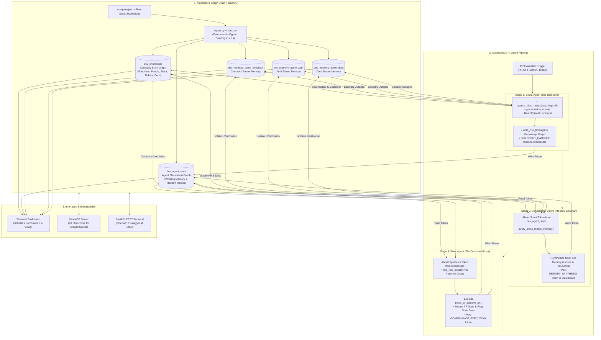
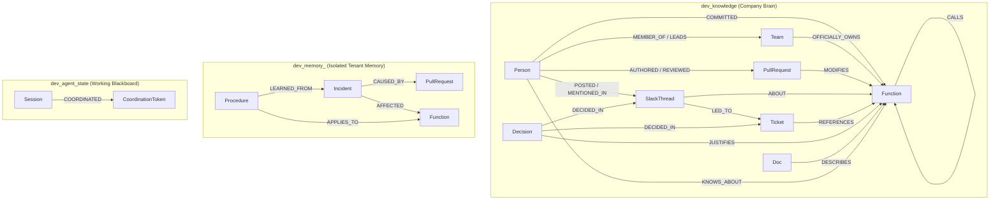

<div align="center">

# NexusGuard 🛡️
### The autonomous company brain that knows the blast radius, tribal history, and forgotten promises behind every line of code.

[](https://falkordb.com)
[](https://modelcontextprotocol.io)
[](https://streamlit.io)
[](https://fastapi.tiangolo.com)
[](test_scenarios.py)

<p>
  <a href="#quick-tour-in-3-minutes">3-Minute Tour</a> •
  <a href="#three-tracks-one-brain">Three Tracks, One Brain</a> •
  <a href="#how-the-brain-works">How It Works</a> •
  <a href="#the-8-benchmark-scenarios">8 Real Scenarios</a> •
  <a href="#run-locally">Run Locally</a> •
  <a href="#mcp-for-coding-agents">MCP for Coding Agents</a> •
  <a href="#repository-map">Repository Map</a>
</p>

</div>

---

## What is NexusGuard?

**NexusGuard is an active engineering governance brain backed by FalkorDB, and an autonomous tri-agent pipeline that acts on it.**

Every engineering team writes code, debates decisions on Slack, files Jira tickets, and survives production outages. But that institutional memory is completely fragmented. When an engineer opens a Pull Request to "clean up an unused if-statement," standard AI review tools inspect the diff in complete isolation.

NexusGuard connects **code call graphs, git commits, Slack commitments, Jira issues, post-mortem incident memories, and safe migration runbooks into one living graph database in FalkorDB**.

On every pull request, three coordinated agents traverse the graph across an active **Graph Blackboard**, retrieve the multi-hop blast radius, recall historical outages, verify contractual promises made months ago, auto-assign the engineer who *actually* understands the code (via recency-decay centrality), and **autonomously blocks the merge** before an outage happens.

> **Diff tools inspect syntax. NexusGuard remembers consequences.**

```
   [ Slack #sales: CEO Promise ]       [ Past Outage: $12k Incident ]       [ Git Commit History ]
                 │                                    │                               │
                 ▼                                    ▼                               ▼
       Decision Provenance                     Episodic Memory                Expert Centrality
         (Why it exists)                     (What broke before)             (Who really knows it)
                 │                                    │                               │
                 └────────────────────────────────────┴───────────────────────────────┘
                                                      │
                                                      ▼
                                       ┌─────────────────────────────┐
                                       │   FalkorDB Company Brain    │
                                       │    Knowledge + Memory       │
                                       └──────────────┬──────────────┘
                                                      │
                                   ┌──────────────────┴──────────────────┐
                                   ▼                                     ▼
                            [ Scout-Agent ]                     [ Fixer-Agent ]
                          Finds the Consequence               Enforces Governance
                         (Blast Radius & Memory)             (Blocks PR & Fixes State)
```

---

## Three Tracks, One Unified System

<table>
<tr>
<td width="33%" valign="top">
<h3>Part 1 · Track 3<br/>Company Brain</h3>
<b>The Connected Org Reality.</b><br/>
Merges code call-trees, Git commits, PRs, Jira tickets, and Slack discussions (<code>#sales</code>, <code>#incidents</code>, <code>#eng</code>) into <code>dev_knowledge</code>. Calculates <b>Recency-Decayed Expertise Centrality</b> to reveal the active domain expert versus the nominal org-chart manager.
</td>
<td width="33%" valign="top">
<h3>Part 2 · Track 2 ⭐<br/>Memory & Coordination</h3>
<b>Tri-Tier Memory & Blackboard.</b><br/>
3 isolated tenant graphs (<code>acme_checkout</code>, <code>acme_auth</code>, <code>acme_data</code>) storing <b>Episodic</b> (outages with USD loss), <b>Procedural</b> (playbooks), and <b>Semantic</b> (runbooks) memory. Agents coordinate without in-memory state via tokens on <code>dev_agent_state</code>.
</td>
<td width="33%" valign="top">
<h3>Part 3 · Track 1<br/>Agents That Act on Data</h3>
<b>Autonomous Action, Not Advice.</b><br/>
Rather than emitting passive markdown, NexusGuard mutates FalkorDB: blocks dangerous merges (<code>MERGE (pr)-[:BLOCKED]->(reason)</code>), flags invalid documentation as stale (<code>is_stale=true</code>), routes review, and enforces migration checklists.
</td>
</tr>
</table>

---

## Quick Tour in 3 Minutes

Open the **Streamlit Web Application** (`http://localhost:8501`) and follow this interactive path:

| Step | Action | What You Observe in FalkorDB |
| :--- | :--- | :--- |
| **1. Overview** | Select **Scenario 1: PR-904 -> `applyDiscount`** | **🛑 CRITICAL RISK // MERGE BLOCKED**. Notice the single-sentence rationale: violates CEO promise in Slack `#sales` (Decision `D-001`) and repeats $12,000 incident `I-007`. |
| **2. Review Routing** | Check the **Assigned Reviewer** badge | NexusGuard assigns **Priya** (active expert, score 14.8), completely bypassing **Asha** (nominal lead who never touched the file) and **Bob** (original author who left the company). |
| **3. Graph Topology** | Navigate to the **Graph View** | Interactive 2D physics canvas reveals `applyDiscount` is called across 6 upstream functions and 2 departments (`Checkout` + `Billing`). Hover over nodes to inspect properties and Cypher queries. |
| **4. Agent Pipeline** | Navigate to the **Agents View** | Watch the 3-stage visual strip: **Scout** (Blast & Provenance) $\rightarrow$ **Consolidator** (Memory & Cross-Tenant Isolation) $\rightarrow$ **Fixer** (Governance Action). Inspect live blackboard tokens on `dev_agent_state`. |
| **5. Multi-Tenant** | Switch to **Scenario 6: PR-330 (`acme_data`)** | Tenant dynamically switches to `dev_memory_acme_data`. Catches GDPR Article 17 non-compliance (Decision `D-005`, $45,000 fine in `I-033`) and auto-assigns DPO Marcus. |
| **6. Non-Crying Wolf** | Switch to **Scenario 3: PR-108 (`renderCart`)** | **✅ SAFE // AUTO-APPROVED**. Zero downstream callers, zero promises, zero past outages. Proves the system permits harmless edits without blocking velocity. |
| **7. Copilot Chat** | Navigate to the **Copilot View** | Click the chip: *"Why was PR-904 blocked?"*. The copilot answers instantly using direct, parameter-grounded Cypher lookups against FalkorDB. |

---

## The Story in 60 Seconds: Why Diff Tools Fail

1. **The Innocent Edit:** A developer opens `PR-904` titled *"Remove dead code in applyDiscount"*. They see an odd legacy `if (clientId == 'CLIENT-X')` branch and delete it. Unit tests pass.
2. **The Unseen Blast Radius:** A 4-hop call traversal finds `checkout() -> calculateTotal() -> applyDiscount() -> chargeStripeInvoice()`. 6 critical functions across 2 teams break.
3. **The Forgotten Promise:** 18 months ago, CEO Sarah promised Client X a 15% discount on Slack in `#sales`. It created Ticket `T-418` and Decision `D-001`. Deleting this code breaches an enterprise contract.
4. **The Repeating Disaster:** 6 months ago, an engineer deleted the exact same line. It triggered Incident `I-007` and caused a **$12,000 billing refund outage**.
5. **The Ghost in the Org Chart:** Static GitHub CODEOWNERS routes the review to team lead Asha. But graph centrality reveals author Bob quit 8 months ago, while Priya emergency-patched it twice and is the true active expert.
6. **NexusGuard Acts:** The merge is **BLOCKED in FalkorDB**. Priya is auto-assigned. Playbook `P-001` (4-step safe migration) is attached. The stale documentation node is flagged.

---

## Architecture & The Tri-Agent Workflow



---

## Graph Data Model & Schema

NexusGuard maintains three distinct graph namespaces in a single FalkorDB instance:



### Recency-Decayed Expertise Centrality
Org charts lie; commit history fades. NexusGuard computes dynamic expertise scores with an explicit half-life decay function:

$$\text{raw} = (\text{commits} \times 1.0) + (\text{reviews} \times 2.0) + (\text{mentions} \times 0.5)$$
$$\text{recency\_decay} = 0.5^{\frac{\text{days\_since\_last\_activity}}{365}}$$
$$\text{score} = \text{round}(\text{raw} \times \text{recency\_decay}, 2)$$

This ensures that **Bob** (22 commits, but left in June 2025) has his score decayed to zero, while **Priya** (9 commits, 2 recent hotfixes) ranks as the primary active reviewer.

---

## The 8 Benchmark Scenarios

Every scenario is reproducible in one click and backed by deterministic graph assertions:

| # | Scenario | Tenant | Function | Risk | Autonomous Outcome & Graph Evidence |
|---|---|---|---|---|---|
| **1** | **Client X Legacy Discount Cleanup** | `acme_checkout` | `applyDiscount` | 🛑 **CRITICAL** | **MERGE BLOCKED**. Catches CEO Slack promise (Decision `D-001`); prevents repeat of $12,000 incident `I-007`; routes to active expert Priya over departed Bob; flags Discount Runbook as stale. |
| **2** | **Stripe Webhook Async Retry** | `acme_checkout` | `chargeStripeInvoice` | ⚠️ **HIGH** | **CONDITIONAL APPROVAL**. Mandates shadow billing replay (Playbook `P-003`) to avoid repeating $8,500 duplicate charge incident `I-019`; routes to top committer Nina. |
| **3** | **Seasonal Cart Promo Banner** | `acme_checkout` | `renderCart` | ✅ **SAFE** | **AUTO-APPROVED**. Zero downstream callers, zero contractual decisions, zero past outages. Proves NexusGuard never cries wolf. |
| **4** | **RS256 JWT Token Upgrade** | `acme_auth` | `verifyJwtToken` | 🛑 **CRITICAL** | **MERGE BLOCKED**. Multi-tenant isolation test. Enforces zero-downtime key rotation playbook `P-002`; assigns Security Lead Alice to prevent repeat of 20-min SSO outage `I-010`. |
| **5** | **Batch Refund Optimization** | `acme_checkout` | `refundOrder` | ⚠️ **MEDIUM** | **CONDITIONAL APPROVAL**. Batch refund pipeline touches critical financial callers; mandates sign-off from top refund committer Priya. |
| **6** | **GDPR Article 17 Purge** | `acme_data` | `hardDeleteAccount` | 🛑 **CRITICAL** | **MERGE BLOCKED**. Direct schema purge bypasses `auditLogEvent`, violating GDPR Article 17 Decision `D-005` ($45,000 fine in `I-033`); auto-assigns DPO Marcus. |
| **7** | **Redis Sliding Window Tightening** | `acme_checkout` | `rateLimitRedisBucket` | ⚠️ **HIGH** | **CONDITIONAL APPROVAL**. Original author Victor departed; assigns active SRE Lead Elena with 5,000 req/sec benchmark mandate per Playbook `P-004` (prevents $28,000 loss `I-025`). |
| **8** | **AES-GCM Encryption Salt Change** | `acme_data` | `encryptPiiField` | ⚠️ **HIGH** | **CONDITIONAL APPROVAL**. Prevents repeat of $18,000 decryption crash across 4,200 profiles (`I-042`); mandates dual-cipher read verification per Playbook `P-006`. |

---

## Onboarding Any Company: Generalized Ingestion

NexusGuard does not rely on hardcoded schemas. The ingestion layer ([`ingest.py`](ingest.py)) normalizes external company dumps into FalkorDB in under one second.

```bash
# Seed default Acme Corp demo
python seed.py

# Onboard any new company dataset
python seed.py --input syn_data_sets/fintech/company.json
python seed.py --input syn_data_sets/medtech/company.json
python seed.py --input unseen/company_unseen.json
```

See [`docs/examples/`](docs/examples/) for sample JSON schema configurations for `company.json`, `slack_export.json`, `jira_export.json`, and `compliance_rules.json`.

---

## Cypher & Graph Mechanics Under the Hood

All graph queries use parameterized Cypher executed via `GRAPH.RO_QUERY` for reads and explicit mutations for governance actions.

### 1. Multi-Hop Blast Radius (`assess_blast_radius`)
```cypher
MATCH q = (c:Function)-[:CALLS*1..5]->(:Function {name: $function_name})
RETURN [x IN nodes(q) | x.name] AS path, length(q) AS hops
ORDER BY hops ASC LIMIT 200
```

### 2. Decision Provenance Chain (`get_decision_chain`)
```cypher
MATCH (d:Decision)-[:JUSTIFIES]->(f:Function {name: $function_name})
OPTIONAL MATCH (d)-[:DECIDED_IN]->(s:SlackThread)
OPTIONAL MATCH (s)-[:LED_TO]->(t:Ticket)
RETURN d.id AS decision_id, d.summary AS summary, s.text AS slack_text,
       s.channel AS channel, t.id AS ticket_id
```

### 3. Blackboard Working-Memory Token (`record_blackboard_token`)
```cypher
MATCH (s:Session {id: $session_id})
CREATE (t:CoordinationToken {
  id: $token_id,
  from_agent: $from_agent,
  to_agent: $to_agent,
  phase: $phase,
  message: $message,
  timestamp: $timestamp,
  payload_json: $payload_json
})
CREATE (s)-[:COORDINATED]->(t)
RETURN t.id AS token_id
```

---

## MCP for Coding Agents (Claude Code, Cursor & Codex)

NexusGuard provides an official **Model Context Protocol (MCP)** server so coding agents can query the company brain before writing or modifying code.

```bash
python mcp_server.py
```

### 10 Exposed FastMCP Tools:
| Tool Name | Scope | Capability |
|---|---|---|
| `assess_blast_radius` | Code Call-Tree | Evaluates multi-hop upstream callers and affected teams up to 5 hops. |
| `find_true_expert` | Centrality | Calculates recency-decay expertise scores and compares against org chart. |
| `get_decision_chain` | Provenance | Traces code back to justification decisions, Jira tickets, and Slack messages. |
| `get_memory_context` | Memory | Retrieves episodic outages (with USD loss) and procedural migration playbooks. |
| `write_risk_finding` | Governance | Scout-Agent logs risk findings directly to the FalkorDB knowledge graph. |
| `block_or_approve_pr` | Governance | Fixer-Agent mutates graph state: sets decision, assigns reviewer, flags stale docs. |
| `record_blackboard_token`| Coordination | Posts coordination tokens and working-memory payloads to `dev_agent_state`. |
| `get_blackboard_session` | Coordination | Retrieves working-memory tokens and handoff traces for a session. |
| `query_cross_tenant_memory`| Multi-Tenant | Probes dependencies across isolated repository memory graphs. |
| `consolidate_new_learning` | Learning | Dynamically mints new incidents and playbooks into FalkorDB in real time. |

### Claude Desktop Configuration
Add to `claude_desktop_config.json`:
```json
{
  "mcpServers": {
    "nexusguard": {
      "command": "python",
      "args": ["/absolute/path/to/falkordb/mcp_server.py"]
    }
  }
}
```

---

## Run Locally in 2 Minutes

### 1. Prerequisites
* **Docker** (for FalkorDB)
* **Python 3.11, 3.12, or 3.13**

### 2. Start FalkorDB
```bash
docker run -p 6379:6379 -p 3000:3000 -d --name falkordb falkordb/falkordb:latest
```
*(FalkorDB web browser UI is accessible at `http://localhost:3000`)*

### 3. Setup Virtual Environment
```bash
python -m venv .venv

# On Windows:
.\.venv\Scripts\activate

# On macOS/Linux:
source .venv/bin/activate

pip install -r requirements.txt
```

### 4. Seed the Multi-Tenant Graphs
```bash
python seed.py
```
*Output: Seeds `dev_knowledge` (26 `KNOWS_ABOUT` edges), 3 isolated tenant memory graphs (`acme_checkout`, `acme_auth`, `acme_data`), and the agent blackboard in $< 1$s.*

### 5. Launch the Streamlit Dashboard
```bash
streamlit run app.py
```
Open **`http://localhost:8501`** in your browser.

### 6. Run the Test Suite
```bash
python test_scenarios.py
python test_ingest.py
python test_unseen.py
```

---

## FastAPI REST Backend

For automated CI/CD webhook integrations:
```bash
uvicorn api:app --host 0.0.0.0 --port 8000 --reload
```
Interactive OpenAPI Swagger docs available at **`http://localhost:8000/docs`**.

---

## Repository Map

| Path | Description |
|---|---|
| [`app.py`](app.py) | Streamlit dashboard (Scholar's Parchment theme, 4 navigation views, 3D ambient canvas) |
| [`agents.py`](agents.py) | Scout, Consolidator, and Fixer agents with FalkorDB Blackboard coordination |
| [`tools.py`](tools.py) | 10 core graph query and mutation tools with parameterized Cypher |
| [`db.py`](db.py) | FalkorDB connection manager (Docker and Cloud switchable) |
| [`scoring.py`](scoring.py) | Half-life recency-decay expertise calculation |
| [`ingest.py`](ingest.py) | Generalized JSON ingestion and normalization engine for external company dumps |
| [`seed.py`](seed.py) | Multi-tenant graph seeder with Cypher index creation |
| [`mcp_server.py`](mcp_server.py) | FastMCP server exposing all 10 tools over stdio |
| [`api.py`](api.py) | FastAPI REST backend for webhook simulation and external integrations |
| [`company.json`](company.json) | Enriched reference dataset (13 engineers, 20 functions, 9 PRs, 8 Slack, 6 incidents, 6 playbooks) |
| [`syn_data_sets/`](syn_data_sets/) | Generalized synthetic datasets across Fintech, Medtech, and Minimal topologies |
| [`unseen/`](unseen/) | Completely unseen enterprise company holdout dataset for validation |
| [`docs/examples/`](docs/examples/) | Sample JSON configurations for onboarding any new company |

---

## Hackathon Notes & Credits

* **Built for:** **FalkorDB Hackathon 2026**
* **Tracks Entered:**
  * **Track 02 (Primary):** Agent Memory & Coordination ⭐
  * **Track 01:** Agents That Act on Connected Data
  * **Track 03:** Company Brain
* **AI Use:** LLMs assist solely with optional natural-language summarization. **All governance verdicts, blast-radius calculations, and reviewer routings are 100% deterministic Cypher executions.**
* **License:** MIT License. Built with [FalkorDB](https://falkordb.com), [FastMCP](https://github.com/jlowin/fastmcp), and [Streamlit](https://streamlit.io).
