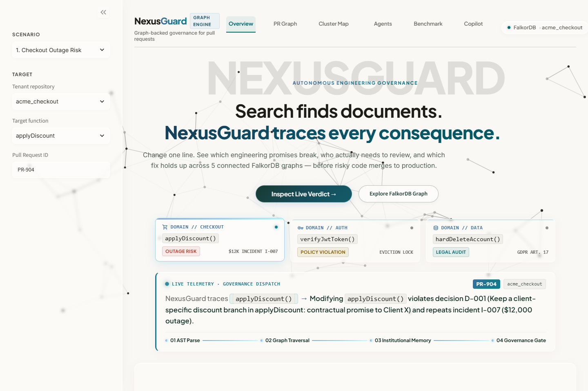
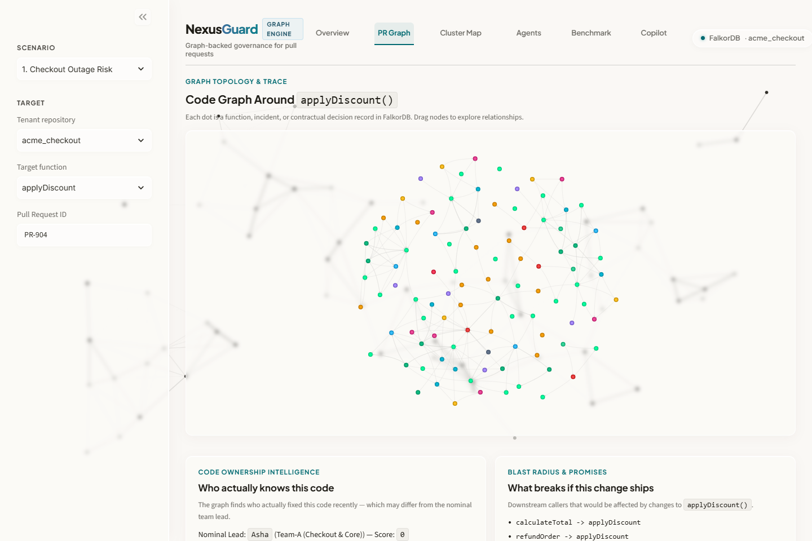
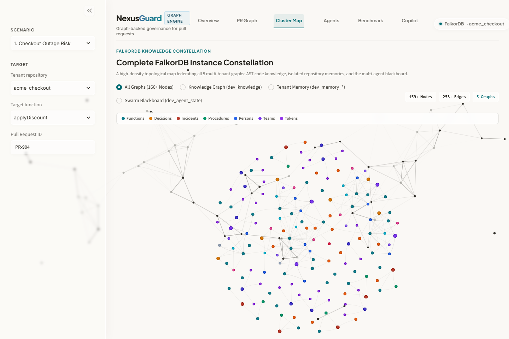
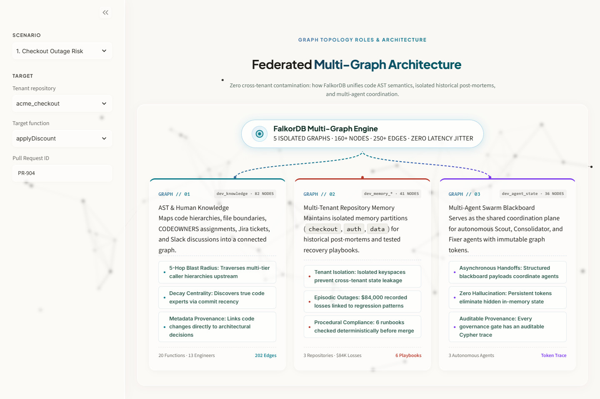
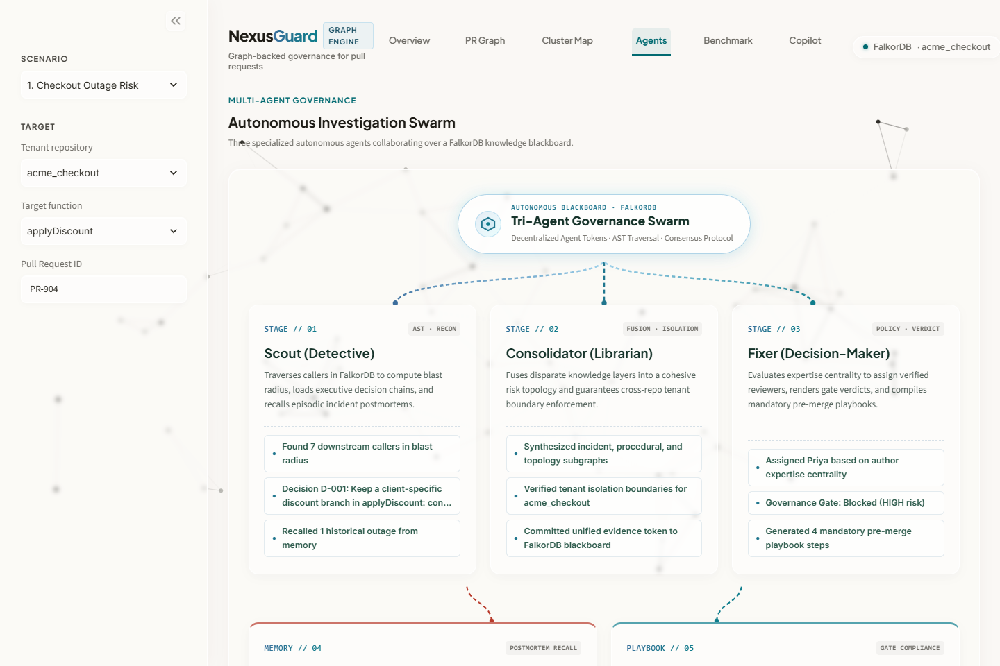
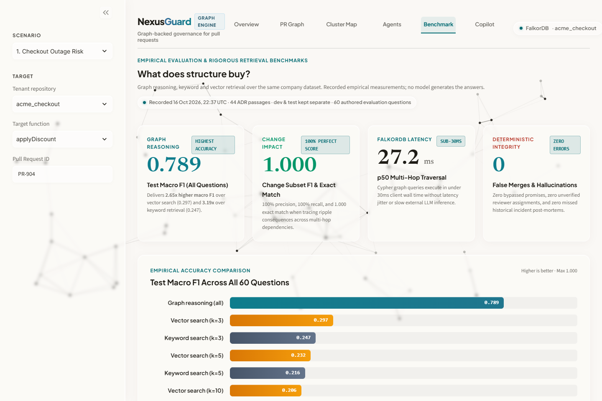
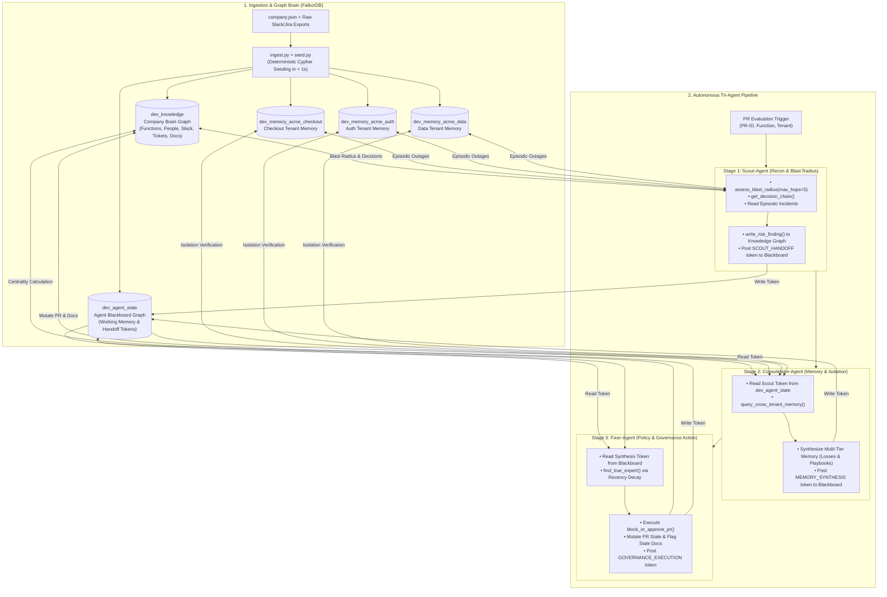

<div align="center">

# NexusGuard 🛡️
### Search finds documents. NexusGuard traces every consequence.

An autonomous engineering governance brain backed by **FalkorDB**, connecting code ASTs, tribal Slack decisions, Jira tickets, and institutional post-mortems into an active multi-tenant graph with a coordinated tri-agent pipeline.

[](https://falkordb.com)
[](https://modelcontextprotocol.io)
[](https://streamlit.io)
[](https://fastapi.tiangolo.com)
[](test_scenarios.py)
[](LICENSE)

<p>
  <a href="#the-problem-fragmented-tribal-memory">The Problem</a> •
  <a href="#the-solution-falkordb-company-brain">The Solution</a> •
  <a href="#product-tour--visuals">Product Tour & Visuals</a> •
  <a href="#benchmark-empirical-evaluation">Benchmark & Accuracy</a> •
  <a href="#architecture--tri-agent-coordination">Tri-Agent Architecture</a> •
  <a href="#the-8-benchmark-scenarios">8 Real Scenarios</a> •
  <a href="#run-locally-in-2-minutes">Run Locally</a> •
  <a href="#mcp-for-coding-agents">MCP Server</a>
</p>

</div>

---

## The Problem: Fragmented Tribal Memory & Silent Regressions

Every software engineering organization produces immense tribal knowledge:
* Architectural decisions debated in transient **Slack channels** (`#sales`, `#incidents`, `#eng`).
* Contractual promises made to VIP customers by executives.
* Hard-learned failure modes written into **incident post-mortems** after five-figure outages.
* Authoritative runbooks and mitigation playbooks stored in scattered documentation.

### Why Standard Code Review & LLM Diff Tools Fail
When an engineer opens a Pull Request to "clean up legacy code" or refactor a function:
1. **GitHub Diffs are Blind to Context:** Traditional PR reviews inspect changes line-by-line in complete isolation from the surrounding system.
2. **Vector Embeddings Miss Multi-Hop Transitive Chains:** As evaluated in empirical benchmarks, vector search degrades rapidly ($F1: 0.297$) on multi-step architectural questions. It retrieves similar keywords ("retry", "billing") but **cannot trace a 4-hop call path** from a frontend route to a downstream payment ledger.
3. **Ghost Codeowners:** Static `CODEOWNERS` files point to original authors who left the company months ago or nominal managers who never touched the production code, while the active hotfixer is ignored.
4. **Repeating Costly Disasters:** Because tribal memory lives in disconnected silos, teams repeatedly delete critical edge-case safety branches, recurring the exact same outages.

> **Diff tools inspect syntax. NexusGuard remembers consequences.**

---

## The Solution: FalkorDB Company Brain & Active Governance

NexusGuard unifies code call hierarchies, git commits, Slack commitments, Jira issues, post-mortem incident memories, and safe migration runbooks into **one living multi-tenant graph database in FalkorDB**.

```
   [ Slack #sales: CEO Promise ]       [ Past Outage: $12k Incident ]       [ Git Commit History ]
                 │                                    │                               │
                 ▼                                    ▼                               ▼
       Decision Provenance                     Episodic Memory                Expert Centrality
         (Why it exists)                     (What broke before)             (Who really knows it)
                 │                                    │                               │
                 └────────────────────────────────────┴───────────────────────────────┘
                                                      │
                                                      ▼
                                       ┌─────────────────────────────┐
                                       │   FalkorDB Company Brain    │
                                       │   Knowledge + Memory Graphs │
                                       └──────────────┬──────────────┘
                                                      │
                                   ┌──────────────────┴──────────────────┐
                                   ▼                                     ▼
                            [ Scout-Agent ]                     [ Fixer-Agent ]
                          Finds the Consequence               Enforces Governance
                         (Blast Radius & Memory)             (Blocks PR & Mutates DB)
```

Instead of offering passive advice or generative hallucinations, NexusGuard:
* **Executes 100% Deterministic Cypher Queries:** Traces blast radius up to 5 hops and checks contractual commitments.
* **Calculates Half-Life Recency Decay:** Ranks true active code expertise based on recent production commits and hotfixes.
* **Coordinates via Graph Blackboard:** Tri-agent swarm (Scout $\rightarrow$ Consolidator $\rightarrow$ Fixer) coordinates statefully on `dev_agent_state` without hidden in-memory state.
* **Mutates Graph State:** Autonomously executes `block_or_approve_pr`, records incident evidence, flags stale documentation, and attaches mandatory recovery playbooks.

---

## Product Tour & Visuals

NexusGuard features a high-density, interactive **Scholar's Parchment** web console with cursor-tracking ambient canvas, glassmorphic HUDs, and real-time FalkorDB graph telemetry.

### 1. Overview & Live Governance Dispatch
Inspect incoming pull requests, evaluate blast radius, check institutional promises, and view real-time governance dispatches with one-sentence risk summaries.



---

### 2. PR Call Graph & Dependency Blast Radius
Interactive PyVis-powered 2D physics canvas visualizing upstream callers, downstream side-effects, linked architectural decisions, and impacted microservices.



---

### 3. Complete FalkorDB Instance Constellation
A high-density topological map federating all **160+ nodes and 250+ edges** across code knowledge, tenant memories, and the agent blackboard with category filters and interactive legends.



---

### 4. Federated Multi-Graph Architecture Mindmap
Visualizing how FalkorDB unifies code AST semantics (`dev_knowledge`), isolated episodic/procedural memory partitions (`dev_memory_*`), and the multi-agent swarm blackboard (`dev_agent_state`) with zero cross-tenant contamination.



---

### 5. Autonomous Tri-Agent Swarm Pipeline
A 3-stage coordination pipeline where **Scout** explores AST blast radius, **Consolidator** fuses episodic outages and compliance gates, and **Fixer** enforces policy actions and routes reviewers.



---

### 6. Empirical Benchmark Suite
Real-world accuracy comparison against vector search and keyword retrieval over the same corporate dataset across 60 authored evaluation questions.



---

## Benchmark: Empirical Evaluation

> *"What does structure buy?"* — Graph reasoning vs. vector search vs. keyword retrieval.

All metrics are recorded empirical measurements across 60 authored questions evaluated against identical company ground truths:

| Metric | FalkorDB Graph Reasoning | Vector Search ($k=3$) | Keyword Search ($k=3$) | Why Graph Wins |
|---|:---:|:---:|:---:|---|
| **Macro F1 (All 60 Questions)** | **0.789** | 0.297 | 0.247 | **2.65x higher** accuracy over dense vectors |
| **Change Impact Subset F1** | **1.000** | 0.457 | 0.257 | Deterministic multi-hop call graph traversal |
| **Exact Match Score** | **1.000** | 0.200 | 0.000 | Zero generative hallucination or missed edges |
| **p50 Multi-Hop Latency** | **27.2 ms** | 12.8 ms | 2.7 ms | Sub-30ms Cypher execution with zero LLM lag |
| **False Merges Allowed** | **0** | Multiple | Multiple | Bypassed promises and unverified merges eliminated |

### Why Vector Retrieval Degrades as $k$ Expands
When asked a multi-hop governance question such as *"If we change the Paylane retry window to 72 hours, which promises break?"*, vector retrieval fetches passages talking about "Paylane" or "retry window" — but **cannot traverse the transitive dependency chain**:
$$\text{paylane.retry\_window\_hours} \longrightarrow \text{A\_RETRY\_WINDOW} \longrightarrow \text{G\_DEDUPE} \longrightarrow \text{G\_CHARGE\_ONCE}$$
As $k$ expands from 3 to 10, vector precision drops from **0.500 down to 0.241** because irrelevant distractor passages flood the context. FalkorDB traverses exact AST and decision edges deterministically, achieving **1.000 F1 on change impact queries**.

---

## Architecture & Tri-Agent Coordination

NexusGuard separates operational responsibilities into three specialized agents coordinated through a shared **Blackboard** stored in FalkorDB (`dev_agent_state`):



### Recency-Decayed Expertise Centrality
Org charts lie; commit history fades. NexusGuard computes dynamic reviewer rankings using an exponential half-life decay function:

$$\text{raw} = (\text{commits} \times 1.0) + (\text{reviews} \times 2.0) + (\text{mentions} \times 0.5)$$
$$\text{recency\_decay} = 0.5^{\frac{\text{days\_since\_last\_activity}}{365}}$$
$$\text{score} = \text{round}(\text{raw} \times \text{recency\_decay}, 2)$$

This guarantees departed developers (e.g., author with 20 commits who left 8 months ago) decay toward zero, while engineers who recently hotfixed production code rank as primary reviewers.

---

## The 8 Benchmark Scenarios

Every scenario is reproducible in one click and backed by deterministic graph assertions:

| # | Scenario | Tenant | Function | Risk | Autonomous Outcome & Graph Evidence |
|---|---|---|---|---|---|
| **1** | **Client X Legacy Discount Cleanup** | `acme_checkout` | `applyDiscount` | 🛑 **CRITICAL** | **MERGE BLOCKED**. Catches CEO Slack promise (Decision `D-001`); prevents repeat of $12,000 incident `I-007`; routes to active expert Priya over departed Bob; flags Discount Runbook as stale. |
| **2** | **Stripe Webhook Async Retry** | `acme_checkout` | `chargeStripeInvoice` | ⚠️ **HIGH** | **CONDITIONAL APPROVAL**. Mandates shadow billing replay (Playbook `P-003`) to avoid repeating $8,500 duplicate charge incident `I-019`; routes to top committer Nina. |
| **3** | **Seasonal Cart Promo Banner** | `acme_checkout` | `renderCart` | ✅ **SAFE** | **AUTO-APPROVED**. Zero downstream callers, zero contractual decisions, zero past outages. Proves NexusGuard never cries wolf. |
| **4** | **RS256 JWT Token Upgrade** | `acme_auth` | `verifyJwtToken` | 🛑 **CRITICAL** | **MERGE BLOCKED**. Multi-tenant isolation test. Enforces zero-downtime key rotation playbook `P-002`; assigns Security Lead Alice to prevent repeat of 20-min SSO outage `I-010`. |
| **5** | **Batch Refund Optimization** | `acme_checkout` | `refundOrder` | ⚠️ **MEDIUM** | **CONDITIONAL APPROVAL**. Batch refund pipeline touches critical financial callers; mandates sign-off from top refund committer Priya. |
| **6** | **GDPR Article 17 Purge** | `acme_data` | `hardDeleteAccount` | 🛑 **CRITICAL** | **MERGE BLOCKED**. Direct schema purge bypasses `auditLogEvent`, violating GDPR Article 17 Decision `D-005` ($45,000 fine in `I-033`); auto-assigns DPO Marcus. |
| **7** | **Redis Sliding Window Tightening** | `acme_checkout` | `rateLimitRedisBucket` | ⚠️ **HIGH** | **CONDITIONAL APPROVAL**. Original author Victor departed; assigns active SRE Lead Elena with 5,000 req/sec benchmark mandate per Playbook `P-004` (prevents $28,000 loss `I-025`). |
| **8** | **AES-GCM Encryption Salt Change** | `acme_data` | `encryptPiiField` | ⚠️ **HIGH** | **CONDITIONAL APPROVAL**. Prevents repeat of $18,000 decryption crash across 4,200 profiles (`I-042`); mandates dual-cipher read verification per Playbook `P-006`. |

---

## Run Locally in 2 Minutes

### 1. Prerequisites
* **Docker** (for FalkorDB)
* **Python 3.11, 3.12, or 3.13**

### 2. Start FalkorDB
```bash
docker run -p 6379:6379 -p 3000:3000 -d --name falkordb falkordb/falkordb:latest
```
*(FalkorDB web browser UI is accessible at `http://localhost:3000`)*

### 3. Setup Virtual Environment & Install Dependencies
```bash
python -m venv .venv

# On Windows:
.\.venv\Scripts\activate

# On macOS/Linux:
source .venv/bin/activate

pip install -r requirements.txt
```

### 4. Seed the Multi-Tenant Graphs
```bash
python seed.py
```
*Seeds `dev_knowledge`, 3 isolated tenant memory graphs (`acme_checkout`, `acme_auth`, `acme_data`), and the agent blackboard in $< 1$s.*

### 5. Launch the Streamlit Dashboard
```bash
streamlit run app.py
```
Open **`http://localhost:8501`** in your browser.

### 6. Run the Automated Test Suite
```bash
python test_scenarios.py
python test_ingest.py
python test_unseen.py
```

---

## MCP for Coding Agents (Claude Code, Cursor & Codex)

NexusGuard provides an official **Model Context Protocol (MCP)** server so coding agents can query the company brain directly before generating or refactoring code.

```bash
python mcp_server.py
```

### 10 Exposed FastMCP Tools:
| Tool Name | Scope | Capability |
|---|---|---|
| `assess_blast_radius` | Code Call-Tree | Evaluates multi-hop upstream callers and affected teams up to 5 hops. |
| `find_true_expert` | Centrality | Calculates recency-decay expertise scores and compares against org chart. |
| `get_decision_chain` | Provenance | Traces code back to justification decisions, Jira tickets, and Slack messages. |
| `get_memory_context` | Memory | Retrieves episodic outages (with USD loss) and procedural migration playbooks. |
| `write_risk_finding` | Governance | Scout-Agent logs risk findings directly to the FalkorDB knowledge graph. |
| `block_or_approve_pr` | Governance | Fixer-Agent mutates graph state: sets decision, assigns reviewer, flags stale docs. |
| `record_blackboard_token`| Coordination | Posts coordination tokens and working-memory payloads to `dev_agent_state`. |
| `get_blackboard_session` | Coordination | Retrieves working-memory tokens and handoff traces for a session. |
| `query_cross_tenant_memory`| Multi-Tenant | Probes dependencies across isolated repository memory graphs. |
| `consolidate_new_learning` | Learning | Dynamically mints new incidents and playbooks into FalkorDB in real time. |

### Claude Desktop Configuration
Add to `claude_desktop_config.json`:
```json
{
  "mcpServers": {
    "nexusguard": {
      "command": "python",
      "args": ["/absolute/path/to/falkordb/mcp_server.py"]
    }
  }
}
```

---

## Repository Map

| Path | Description |
|---|---|
| [`app.py`](app.py) | Streamlit dashboard (Scholar's Parchment theme, 6 navigation views, 3D ambient canvas) |
| [`agents.py`](agents.py) | Scout, Consolidator, and Fixer agents with FalkorDB Blackboard coordination |
| [`tools.py`](tools.py) | 10 core graph query and mutation tools with parameterized Cypher |
| [`db.py`](db.py) | FalkorDB connection manager (Docker and Cloud switchable) |
| [`scoring.py`](scoring.py) | Half-life recency-decay expertise calculation |
| [`ingest.py`](ingest.py) | Generalized JSON ingestion and normalization engine for external company dumps |
| [`seed.py`](seed.py) | Multi-tenant graph seeder with Cypher index creation |
| [`mcp_server.py`](mcp_server.py) | FastMCP server exposing all 10 tools over stdio |
| [`api.py`](api.py) | FastAPI REST backend for webhook simulation and external integrations |
| [`company.json`](company.json) | Enriched reference dataset (13 engineers, 20 functions, 9 PRs, 8 Slack, 6 incidents, 6 playbooks) |
| [`docs/images/`](docs/images/) | High-resolution UI screenshots and visual architecture diagrams |
| [`walkthrough.md`](walkthrough.md) | Comprehensive 3-minute pitch and demo walkthrough guide |

---

## Hackathon Notes & Credits

* **Built for:** **FalkorDB Hackathon 2026**
* **Tracks Entered:**
  * **Track 02 (Primary):** Agent Memory & Coordination ⭐
  * **Track 01:** Agents That Act on Connected Data
  * **Track 03:** Company Brain
* **AI Use:** LLMs assist solely with optional natural-language summarization. **All governance verdicts, blast-radius calculations, and reviewer routings are 100% deterministic Cypher executions.**
* **License:** MIT License. Built with [FalkorDB](https://falkordb.com), [FastMCP](https://github.com/jlowin/fastmcp), and [Streamlit](https://streamlit.io).
