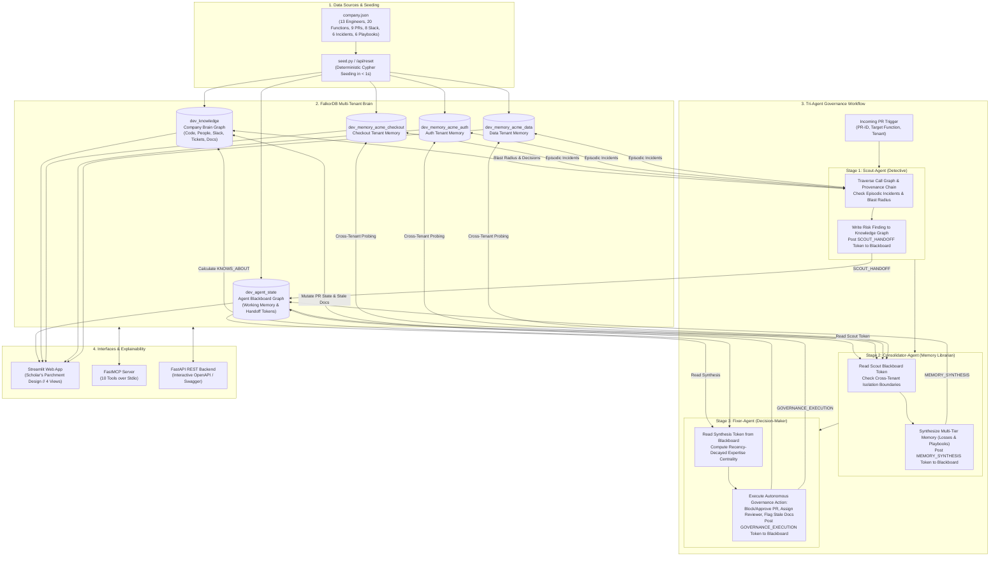

# NexusGuard 🛡️
### Autonomous Graph-Backed Engineering Governance Brain

[](https://falkordb.com)
[](https://modelcontextprotocol.io)
[](https://streamlit.io)
[](https://python.org)
[](https://fastapi.tiangolo.com)
[](https://opensource.org/licenses/MIT)

> **FalkorDB Hackathon 2026 Submission**  
> **Tracks Satisfied:** Track 01 (Agents That Act on Connected Data), Track 02 (Agent Memory & Coordination) ⭐, Track 03 (Company Brain)

---

## 📌 Executive Summary & The Problem

When a developer opens a Pull Request today, standard review tools and AI assistants (e.g. GitHub Copilot) inspect code diffs in total isolation. They suffer from three fatal enterprise blind spots:

1. **Unseen Blast Radius:** A bot cannot see that modifying a seemingly harmless helper function like `applyDiscount()` impacts a 4-hop downstream payment and billing pipeline spanning multiple teams.
2. **Org Chart Illusion vs. Tribal Knowledge:** Static rules request reviews from nominal leads on the formal org chart. In reality, graph interaction history shows the original author left the company months ago, and an active engineer from another department hot-fixed it during recent emergencies and is the true domain expert.
3. **Institutional Amnesia & Missing Provenance:** Review bots do not remember that deleting an odd legacy branch caused a **$12,000 billing outage** six months ago. Nor can they trace that the branch exists solely because the CEO made a contractual discount commitment to a key client in a Slack thread 18 months ago.

### The Solution: NexusGuard
**NexusGuard** bridges code call trees, Git history, Slack threads, Jira tickets, post-mortem outages, and safe migration procedures into a unified **FalkorDB knowledge brain**.

When a PR is opened or simulated, a **Tri-Agent Coordination Pipeline** autonomously traverses the graph across an active **Graph Blackboard**, queries multi-tier episodic and procedural memories across isolated tenants, determines true domain experts, blocks dangerous merges, flags obsolete documentation, and provides visual and conversational explainability.

---

## 🏆 Hackathon Tracks Alignment

| Track | NexusGuard Implementation | FalkorDB Graph Mechanism |
|---|---|---|
| **Track 01: Agents That Act on Connected Data** | Autonomous governance execution: Rather than just advising, NexusGuard mutates graph state—blocking dangerous PRs, auto-assigning verified experts, flagging stale runbooks, and enforcing sequential migration checklists. | Cypher mutations: `MERGE (pr)-[:BLOCKED]->(reason)`, `SET doc.is_stale = true`, `MERGE (p)-[:ASSIGNED_REVIEWER]->(pr)`, `MERGE (pr)-[:REQUIRES_PLAYBOOK]->(pb)`. |
| **Track 02: Agent Memory & Coordination** ⭐ *(Primary Track)* | **1. Tri-Tier Memory Architecture:** Explicit Episodic (past outages with USD financial losses), Procedural (sequential playbooks), Semantic (architectural contracts), and Working Memory.<br/>**2. Graph-Based Blackboard:** Inter-agent working memory tokens stored directly in `dev_agent_state` with phase transitions.<br/>**3. Multi-Tenant Isolation & Cross-Tenant Coordination:** 3 isolated tenant memory graphs (`acme_checkout`, `acme_auth`, `acme_data`) bridged dynamically by `Consolidator-Agent` without leaking code.<br/>**4. Dynamic Learning:** Post-incident learning tool (`consolidate_new_learning`) dynamically mints new incident nodes and learned playbooks into FalkorDB in real time. | Isolated tenant graphs (`select_graph(f"{PREFIX}_memory_{repo}")`), blackboard coordination workspace (`select_graph(f"{PREFIX}_agent_state")`), `(:Session)-[:COORDINATED]->(:CoordinationToken)`, and `(:Procedure)-[:LEARNED_FROM]->(:Incident)`. |
| **Track 03: Company Brain** | Dynamic enterprise graph connecting code call trees, Git commits, PRs, Jira tickets, and Slack discussions (`#sales`, `#incidents`, `#infra-warroom`, `#crypto-security`) with **Recency-Decay Expertise Centrality**. | Recency scoring: `score = (commits*1.0 + reviews*2.0 + mentions*0.5) * 0.5^(days_ago/365)` contrasting the official org chart against true tribal knowledge. |

---

## 🏛️ System Architecture & End-to-End Workflow



### The 5-Phase End-to-End Governance Execution
1. **Trigger Phase:** The developer or CI/CD simulator submits a PR target (e.g. `PR-904` touching `applyDiscount` in `acme_checkout`).
2. **Phase 1 — Scout-Agent (Risk & Discovery):**
   * Traverses up to 5 hops of `[:CALLS]` relationships to compute upstream callers and affected teams.
   * Walks the provenance chain `(:Function)<-[:JUSTIFIES]-(:Decision)-[:DECIDED_IN]->(:SlackThread)` to verify if the code exists due to an executive commitment.
   * Reads episodic incident memory from the tenant graph (`dev_memory_<repo>`).
   * Writes the risk assessment finding node into `dev_knowledge` and posts a `SCOUT_HANDOFF` token to the blackboard `dev_agent_state`.
3. **Phase 2 — Consolidator-Agent (Memory Synthesis & Cross-Tenant Coordination):**
   * Reads the `SCOUT_HANDOFF` token from the blackboard.
   * Executes `query_cross_tenant_memory` to verify whether call paths cross into foreign repositories without leaking internal code.
   * Synthesizes episodic financial losses, procedural migration playbooks, and semantic runbooks into a unified memory context.
   * Posts a `MEMORY_SYNTHESIS` token to `dev_agent_state`.
4. **Phase 3 — Fixer-Agent (Remediation & Autonomous Governance Action):**
   * Reads the consolidated blackboard state.
   * Queries `dev_knowledge` for `(:Person)-[:KNOWS_ABOUT]->(:Function)` recency-decay centrality to identify the true domain expert (distinguishing departed authors from active engineers).
   * Executes the governance verdict: `BLOCKED`, `CONDITIONAL_APPROVAL`, or `AUTO_APPROVED`.
   * Mutates graph state: links PR to blocker reason, assigns the verified expert as reviewer, and flags governing documentation nodes with `is_stale = true`.
   * Posts a `GOVERNANCE_EXECUTION` token to `dev_agent_state`.
5. **Phase 4 — Explainability & Interface Delivery:**
   * Delivers results across the Streamlit dashboard, FastMCP tools, and REST API.

---

## 🗄️ Graph Data Model & Multi-Tenant Schema

NexusGuard coordinates three distinct graph layers hosted in FalkorDB:

### 1. Company Brain Knowledge Graph (`dev_knowledge`)
* **Nodes:**
  * `Person` (`id`, `name`, `active`, `left_on`)
  * `Team` (`id`, `name`, `repo`)
  * `Function` (`name`, `file`, `repo`)
  * `PullRequest` (`id`, `title`, `date`, `state`, `risk_level`, `repo`)
  * `SlackThread` (`id`, `channel`, `date`, `text`)
  * `Ticket` (`id`, `title`, `status`, `date`)
  * `Decision` (`id`, `summary`, `date`)
  * `Doc` (`id`, `title`, `last_updated`, `is_stale`, `repo`)
* **Relationships:**
  * `(:Person)-[:MEMBER_OF | :LEADS]->(:Team)`
  * `(:Team)-[:OFFICIALLY_OWNS]->(:Function)`
  * `(:Function)-[:CALLS]->(:Function)`
  * `(:Person)-[:COMMITTED {count, last}]->(:Function)`
  * `(:Person)-[:AUTHORED | :REVIEWED]->(:PullRequest)`
  * `(:PullRequest)-[:MODIFIES]->(:Function)`
  * `(:Person)-[:POSTED | :MENTIONED_IN]->(:SlackThread)`
  * `(:SlackThread)-[:ABOUT]->(:Function)`
  * `(:SlackThread)-[:LED_TO]->(:Ticket)`
  * `(:Ticket)-[:REFERENCES]->(:Function)`
  * `(:Decision)-[:JUSTIFIES]->(:Function)`
  * `(:Decision)-[:DECIDED_IN]->(:SlackThread | :Ticket)`
  * `(:Doc)-[:DESCRIBES]->(:Function)`
  * `(:Person)-[:KNOWS_ABOUT {score, commits, reviews, mentions, last_activity}]->(:Function)`

### 2. Multi-Tenant Memory Graphs (`dev_memory_<repo>`)
Isolated per tenant (`acme_checkout`, `acme_auth`, `acme_data`) for strict regulatory and privacy boundaries:
* **Nodes:** `Incident` (`id`, `date`, `loss_usd`, `summary`), `Procedure` (`id`, `title`, `steps`), plus stub `Function` and `PullRequest`.
* **Relationships:**
  * `(:Incident)-[:CAUSED_BY]->(:PullRequest)`
  * `(:Incident)-[:AFFECTED]->(:Function)`
  * `(:Procedure)-[:LEARNED_FROM]->(:Incident)`
  * `(:Procedure)-[:APPLIES_TO]->(:Function)`

### 3. Agent Coordination Blackboard Graph (`dev_agent_state`)
Enables inter-agent working memory state handoffs without hidden in-memory state:
* **Nodes:** `Session` (`id`, `created_at`), `CoordinationToken` (`id`, `token_id`, `from_agent`, `to_agent`, `phase`, `message`, `timestamp`, `payload`)
* **Relationships:** `(:Session)-[:COORDINATED]->(:CoordinationToken)`

### Recency-Decayed Expertise Centrality
To find who *truly* understands the code rather than relying on org-chart assumptions:
$$\text{raw} = (\text{commits} \times 1.0) + (\text{reviews} \times 2.0) + (\text{mentions} \times 0.5)$$
$$\text{recency\_decay} = 0.5^{\frac{\text{days\_since\_last\_activity}}{365}}$$
$$\text{score} = \text{round}(\text{raw} \times \text{recency\_decay}, 2)$$

---

## 🎨 Streamlit Web Dashboard: Scholar's Parchment Design

The user interface implements the **Scholar's Parchment Design System** (warm off-white `#faf8f5`, ink `#27251e`, graphite `#72706b`, deep teal `#016a71`, and risk red `#b83a2b`) with an ambient interactive 3D constellation canvas.

```
┌────────────────────────────────────────────────────────────────────────┐
│  NexusGuard GRAPH ENGINE   Overview   Graph   Agents   Copilot   ● FalkorDB │
└────────────────────────────────────────────────────────────────────────┘
```

The application provides **4 dedicated top-level views**:

1. **Overview (Landing View):**
   * **Governance Objective Card:** What the system is evaluating, target repository, function, and contextual summary.
   * **Automated Decision Verdict Card:** Distinct verdict pill (`Merge Blocked`, `Conditional Approval`, `Auto-Approved`), assigned expert reviewer, risk level badge, count of invalidated documentation, and a crisp "Why in one sentence" summary.
   * **Collapsible Action Plan ("What happens next"):** Sequential checklist required before merging.
2. **Graph (Visual Topology & Centrality View):**
   * **Interactive PyVis 2D Physics Canvas:** Force-directed graph with draggable nodes, zoom/pan controls, edge labels, and hover tooltips showing callers, callees, tickets, decisions, and incidents.
   * **Org Chart vs. True Knowledge Centrality:** Side-by-side comparison proving why nominal leads (e.g. Asha) are bypassed in favor of active contributors (e.g. Priya).
   * **Blast Radius Call-Tree:** Tabular breakdown of upstream callers and impacted teams.
3. **Agents (Pipeline & Multi-Tier Memory View):**
   * **Tri-Agent Pipeline Strip:** Visual 3-stage progression with directional indicators (`Stage 1: Scout` $\rightarrow$ `Stage 2: Consolidator` $\rightarrow$ `Stage 3: Fixer`).
   * **Episodic Memory Card:** Past outages caused by modifying this code, including financial losses and dates.
   * **Procedural Playbook Card:** Mandatory checklists synthesized from historical post-mortems.
   * **Blackboard Inspector:** Full coordination audit trail of tokens and timestamps exchanged over `dev_agent_state`.
4. **Copilot (Conversational Governance View):**
   * **Scenario Context Banner:** Active PR evaluation target, verdict, and assigned reviewer.
   * **In-Copilot Scenario Switcher:** Switch benchmark scenarios directly from the chat interface.
   * **Dynamic Scenario Suggestion Chips:** Contextual 1-click prompts (e.g. *"Why was PR-904 blocked?"*, *"Who knows about applyDiscount()?"*, *"Explain incident I-007 ($12,000)"*).
   * **Interactive Graph-Grounded Q&A:** Natural language chat answers verified directly against FalkorDB Cypher queries.

---

## ⚡ 8 Benchmark Scenarios

| # | Scenario / PR | Tenant | Target Function | Risk Level | Autonomous Outcome & Graph Evidence |
|---|---|---|---|---|---|
| **1** | **Client X Legacy Discount Cleanup** (`PR-904`) | `acme_checkout` | `applyDiscount` | 🛑 **CRITICAL** | **MERGE BLOCKED**. Violates CEO Slack promise in `#sales` to Client X (Decision `D-001`); prevents repeating $12,000 outage `I-007`; auto-assigns active expert Priya over departed author Bob; flags Discount Runbook as stale. |
| **2** | **Stripe Webhook Async Retry** (`PR-512`) | `acme_checkout` | `chargeStripeInvoice` | ⚠️ **HIGH** | **CONDITIONAL APPROVAL**. Mandates shadow billing replay (Playbook `P-003`) to prevent repeating $8,500 duplicate charge incident `I-019`; auto-assigns top billing committer Nina. |
| **3** | **Seasonal Cart Promo Banner** (`PR-108`) | `acme_checkout` | `renderCart` | ✅ **SAFE** | **AUTO-APPROVED**. Zero downstream callers, zero contractual decisions, zero past outages. Proves NexusGuard does not "cry wolf". |
| **4** | **RS256 JWT Token Upgrade** (`PR-401`) | `acme_auth` | `verifyJwtToken` | 🛑 **CRITICAL** | **MERGE BLOCKED**. Multi-tenant isolation demonstration. Enforces zero-downtime key rotation playbook `P-002`; auto-assigns Security Lead Alice to prevent repeat of 20-min SSO outage `I-010`. |
| **5** | **Batch Refund Optimization** (`PR-770`) | `acme_checkout` | `refundOrder` | ⚠️ **MEDIUM** | **CONDITIONAL APPROVAL**. Batch refund queue touches critical checkout pipeline; mandates sign-off from top refund expert Priya. |
| **6** | **GDPR Article 17 Purge** (`PR-330`) | `acme_data` | `hardDeleteAccount` | 🛑 **CRITICAL** | **MERGE BLOCKED**. Direct schema purge bypasses `auditLogEvent`, violating GDPR Article 17 Decision `D-005` (repeats $45,000 regulatory fine in `I-033`); auto-assigns Data Protection Officer Marcus. |
| **7** | **Redis Sliding Window Tightening** (`PR-610`) | `acme_checkout` | `rateLimitRedisBucket` | ⚠️ **HIGH** | **CONDITIONAL APPROVAL**. Author Victor departed; detects knowledge vacuum and assigns active SRE Lead Elena with 5,000 req/sec benchmark mandate per Playbook `P-004` (prevents $28,000 loss `I-025`). |
| **8** | **AES-GCM Encryption Salt Change** (`PR-350`) | `acme_data` | `encryptPiiField` | ⚠️ **HIGH** | **CONDITIONAL APPROVAL**. Prevents repeat of $18,000 decryption crash across 4,200 profiles (`I-042`); mandates dual-cipher read verification per Playbook `P-006`. |

---

## 🚀 Quick Start Guide

### 1. Prerequisites
* **Docker** (to run FalkorDB)
* **Python 3.11, 3.12, or 3.13**

### 2. Start FalkorDB
```bash
docker run -p 6379:6379 -p 3000:3000 -d --name falkordb falkordb/falkordb:latest
```
> FalkorDB browser UI is accessible at `http://localhost:3000`.

### 3. Setup Virtual Environment
```bash
# Clone the repository and navigate into it
cd falkordb

# Create and activate virtual environment
python -m venv .venv

# On Windows:
.\.venv\Scripts\activate

# On macOS/Linux:
source .venv/bin/activate

# Install dependencies
pip install -r requirements.txt
```

### 4. Configure Environment
Create a `.env` file from `.env.example`:
```bash
cp .env.example .env
```
Default configuration connects to local Docker (`localhost:6379`). FalkorDB Cloud endpoints are also supported by supplying `FALKORDB_HOST` and credentials in `.env`.

### 5. Seed FalkorDB Graphs
```bash
python seed.py
```
*Seeds `dev_knowledge` (26 `KNOWS_ABOUT` edges), 3 isolated tenant memory graphs (`acme_checkout`, `acme_auth`, `acme_data`), and the agent blackboard in $< 1$ second.*

### 6. Launch the Streamlit Dashboard
```bash
streamlit run app.py
```
Open **`http://localhost:8501`** in your browser.

---

## 🛠️ FastMCP Server (Model Context Protocol)

NexusGuard exposes 10 graph governance tools over Model Context Protocol (MCP) using stdio transport:

```bash
python mcp_server.py
```

### Exposed MCP Tools (10 Tools)
| Tool Name | Scope / Track | Description |
|---|---|---|
| `assess_blast_radius` | Track 01 & 03 | Computes multi-hop upstream callers and affected teams up to 5 hops. |
| `find_true_expert` | Track 03 | Computes recency-decay expertise centrality and compares to official org chart. |
| `get_decision_chain` | Track 03 | Traces code back to justification decisions, Jira tickets, and CEO Slack messages. |
| `get_memory_context` | Track 02 | Retrieves episodic outages (with USD losses) and procedural migration playbooks. |
| `write_risk_finding` | Track 01 & 02 | Scout-Agent logs risk findings directly to the FalkorDB knowledge graph. |
| `block_or_approve_pr` | Track 01 & 02 | Fixer-Agent mutates graph state: sets decision, assigns reviewer, flags stale docs. |
| `record_blackboard_token` | Track 02 | Posts coordination tokens and working-memory payloads to `dev_agent_state`. |
| `get_blackboard_session` | Track 02 | Retrieves working-memory tokens and handoff traces for a session. |
| `query_cross_tenant_memory`| Track 02 | Probes dependencies across isolated repository memory graphs. |
| `consolidate_new_learning` | Track 02 | Dynamically mints new incidents and playbooks into FalkorDB in real time. |

### Connecting to Claude Desktop / Cursor
Add to your `claude_desktop_config.json`:
```json
{
  "mcpServers": {
    "nexusguard": {
      "command": "python",
      "args": ["C:/Users/sjpri/Desktop/falkordb/mcp_server.py"]
    }
  }
}
```

---

## 🌐 FastAPI REST Backend

NexusGuard provides a high-performance REST API for CI/CD webhook integrations and external dashboards:

```bash
uvicorn api:app --host 0.0.0.0 --port 8000 --reload
```

Interactive OpenAPI Swagger docs are available at **`http://localhost:8000/docs`**.

### Key REST Endpoints:
* `POST /api/simulate`: Triggers the end-to-end Tri-Agent simulation for a PR.
* `GET /api/graph`: Returns nodes and edges formatted for PyVis / NetworkX.
* `GET /api/tenants`: Lists available isolated repository tenants and functions.
* `POST /api/reset`: Deterministically reseeds all FalkorDB graphs in $< 1$ second.
* `GET /api/tools/*`: Direct REST endpoints for blast radius, expertise, provenance, and memory.

---

## 🧪 Automated Test Suite

Run the tool test suite without requiring an external MCP client:
```bash
python test_tools.py
```
Validates blast radius traversal, expertise scoring, decision chains, episodic memory lookup, blackboard tokens, cross-tenant bridging, and dynamic learning.

---

## 📁 Repository Structure

```
falkordb/
├── company.json          # Enriched company dataset (13 engineers, 20 functions, 9 PRs, 8 Slack, 6 incidents, 6 playbooks)
├── seed.py               # Deterministic multi-tenant graph seeder with Cypher indexes & recency scoring
├── scoring.py            # Recency-decay expertise centrality calculation
├── db.py                 # FalkorDB connection manager (Docker & Cloud switchable)
├── tools.py              # 10 core graph query & mutation tools
├── agents.py             # Scout, Consolidator, and Fixer agents with FalkorDB Blackboard coordination
├── api.py                # FastAPI REST endpoints & tool mappings
├── mcp_server.py         # FastMCP stdio server (10 tools exposed)
├── app.py                # Streamlit dashboard (Scholar's Parchment design, 4 views, 3D ambient constellation)
├── test_tools.py         # Automated test suite for all 10 tools
├── walkthrough.md        # Comprehensive 3-minute demo pitch & judge script
├── requirements.txt      # Python dependencies
├── .env.example          # Environment variable template
└── .gitignore            # Git ignore rules
```

---

## ⚖️ License & Acknowledgements

* **License:** MIT License. Built for the **FalkorDB Hackathon 2026**.
* Powered by [FalkorDB](https://falkordb.com), [FastMCP](https://github.com/jlowin/fastmcp), and [Streamlit](https://streamlit.io).
