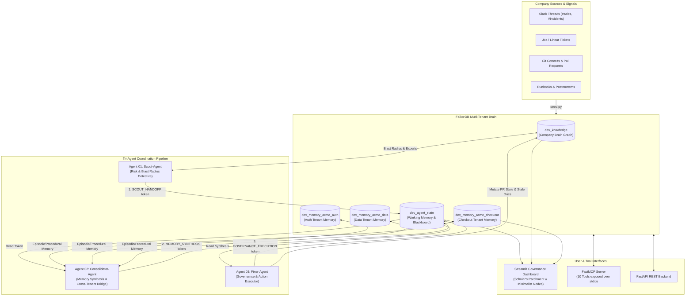

# NexusGuard 🛡️
### Autonomous Graph-Backed Engineering Governance Brain

[](https://falkordb.com)
[](https://modelcontextprotocol.io)
[](https://streamlit.io)
[](https://python.org)

> **Submission for the FalkorDB Hackathon**  
> **Tracks Satisfied:** Track 01 (Agents That Act on Connected Data), Track 02 (Agent Memory & Coordination), Track 03 (Company Brain)

---

## The Problem
When a developer opens a Pull Request today, tools like GitHub Copilot only inspect the code diff in isolation. They have zero visibility into:
1. **Load-bearing legacy context:** The Slack debate where the CEO promised a client a contractual discount override 18 months ago.
2. **Episodic memory of past disasters:** That deleting this exact `if-statement` caused a $12,000 billing outage six months ago.
3. **Departed authors vs. true experts:** The original author quit last year; the official team lead never touched the code; but an engineer on another team emergency-patched it twice.

**NexusGuard** bridges code, conversations, people, and incident history into a unified **FalkorDB graph brain**. Three autonomous AI agents coordinate across an active graph blackboard to detect risks, synthesize multi-tier memory, prevent recurring outages, and enforce safe migration playbooks.

---

## 🏆 Hackathon Tracks Alignment

| Track | NexusGuard Implementation | Graph Mechanism |
|---|---|---|
| **Track 01: Agents That Act on Connected Data** | Autonomous governance action: Blocks dangerous PRs, auto-assigns active experts, flags documentation as stale, and enforces checklists directly in the graph. | Cypher mutations: `MERGE (pr)-[:BLOCKED]->(reason)`, `SET doc.is_stale = true`, `MERGE (p)-[:ASSIGNED_REVIEWER]->(pr)` |
| **Track 02: Agent Memory & Coordination** ⭐ *(Primary Highlight)* | **1. Tri-Tier Memory Architecture:** Episodic (past outages), Procedural (safe playbooks), Semantic (contracts/ADRs), and Working Memory.<br/>**2. Graph-Based Blackboard:** Multi-agent handoff tokens stored directly in `dev_agent_state` without hidden in-memory state.<br/>**3. Multi-Tenant Isolation & Cross-Tenant Coordination:** Isolated memory graphs (`dev_memory_<repo>`) bridged dynamically by `Consolidator-Agent`.<br/>**4. Dynamic Learning:** Post-incident consolidation mintage into FalkorDB in real time. | Isolated tenant graphs (`select_graph(f"{PREFIX}_memory_{repo}")`), blackboard workspace (`select_graph(f"{PREFIX}_agent_state")`), `(:Session)-[:COORDINATED]->(:CoordinationToken)`, and `(:Procedure)-[:LEARNED_FROM]->(:Incident)`. |
| **Track 03: Company Brain** | Dynamic knowledge graph connecting Slack discussions (`#sales`, `#incidents`, `#eng`), Jira tickets, and GitHub commits with **Recency-Decay Expertise Centrality**. | Recency scoring: `score = (commits*1 + reviews*2 + mentions*0.5) * 0.5^(days_ago/365)` |

---

## 🏛️ Architecture & Multi-Agent Coordination



---

## 🗄️ Graph Data Model & Multi-Tenant Schema

NexusGuard uses three distinct graph layers hosted within FalkorDB:

### 1. Company Brain Knowledge Graph (`dev_knowledge`)
* **Nodes:**
  * `Person` (`id`, `name`, `active`, `left_on`)
  * `Team` (`id`, `name`, `repo`)
  * `Function` (`name`, `file`, `repo`)
  * `PullRequest` (`id`, `title`, `date`, `state`, `risk_level`, `repo`)
  * `SlackThread` (`id`, `channel`, `date`, `text`)
  * `Ticket` (`id`, `title`, `status`, `date`)
  * `Decision` (`id`, `summary`, `date`)
  * `Doc` (`id`, `title`, `last_updated`, `is_stale`, `repo`)
* **Relationships:**
  * `(:Person)-[:MEMBER_OF | :LEADS]->(:Team)`
  * `(:Team)-[:OFFICIALLY_OWNS]->(:Function)`
  * `(:Function)-[:CALLS]->(:Function)`
  * `(:Person)-[:COMMITTED {count, last}]->(:Function)`
  * `(:Person)-[:AUTHORED | :REVIEWED]->(:PullRequest)`
  * `(:PullRequest)-[:MODIFIES]->(:Function)`
  * `(:Person)-[:POSTED | :MENTIONED_IN]->(:SlackThread)`
  * `(:SlackThread)-[:ABOUT]->(:Function)`
  * `(:SlackThread)-[:LED_TO]->(:Ticket)`
  * `(:Ticket)-[:REFERENCES]->(:Function)`
  * `(:Decision)-[:JUSTIFIES]->(:Function)`
  * `(:Decision)-[:DECIDED_IN]->(:SlackThread | :Ticket)`
  * `(:Doc)-[:DESCRIBES]->(:Function)`
  * `(:Person)-[:KNOWS_ABOUT {score, commits, reviews, mentions, last_activity}]->(:Function)`

### 2. Multi-Tenant Memory Graphs (`dev_memory_<repo>`)
Isolated per tenant (`acme_checkout`, `acme_auth`, `acme_data`) for strict regulatory and privacy boundaries:
* **Nodes:** `Incident` (`id`, `date`, `loss_usd`, `summary`), `Procedure` (`id`, `title`, `steps`), plus stub `Function` and `PullRequest`.
* **Relationships:**
  * `(:Incident)-[:CAUSED_BY]->(:PullRequest)`
  * `(:Incident)-[:AFFECTED]->(:Function)`
  * `(:Procedure)-[:LEARNED_FROM]->(:Incident)`
  * `(:Procedure)-[:APPLIES_TO]->(:Function)`

### 3. Agent Coordination Blackboard Graph (`dev_agent_state`)
Enables working-memory state handoffs between agents without hidden in-memory state:
* **Nodes:** `Session` (`id`, `created_at`), `CoordinationToken` (`id`, `token_id`, `from_agent`, `to_agent`, `phase`, `message`, `timestamp`, `payload`)
* **Relationships:** `(:Session)-[:COORDINATED]->(:CoordinationToken)`

### Recency-Decayed Expertise Centrality
$$\text{raw} = (\text{commits} \times 1.0) + (\text{reviews} \times 2.0) + (\text{mentions} \times 0.5)$$
$$\text{score} = \text{round}\left(\text{raw} \times 0.5^{\frac{\text{days\_since\_last\_activity}}{365}}, 2\right)$$

---

## ⚡ 8 Benchmark Scenarios

| # | Scenario | Tenant | Function | Risk Level | Autonomous Outcome |
|---|---|---|---|---|---|
| **1** | **Client X Legacy Discount Cleanup** | `acme_checkout` | `applyDiscount` | 🛑 **CRITICAL** | **MERGE BLOCKED**. CEO promise caught in Slack `#sales`; prevents repeating $12,000 incident I-007; assigns active expert Priya over departed Bob. |
| **2** | **Stripe Webhook Async Retry** | `acme_checkout` | `chargeStripeInvoice` | ⚠️ **HIGH** | **CONDITIONAL APPROVAL**. Mandates shadow billing replay to prevent $8,500 duplicate charge incident I-019. |
| **3** | **Seasonal Cart Promo Banner** | `acme_checkout` | `renderCart` | ✅ **SAFE** | **AUTO-APPROVED**. Zero downstream callers, zero promises, zero past outages. |
| **4** | **RS256 JWT Token Upgrade** | `acme_auth` | `verifyJwtToken` | 🛑 **CRITICAL** | **MERGE BLOCKED**. Enforces zero-downtime key rotation playbook P-002; auto-assigns security lead Alice. |
| **5** | **Batch Refund Optimization** | `acme_checkout` | `refundOrder` | ⚠️ **MEDIUM** | **CONDITIONAL APPROVAL**. Requires sign-off from top refund committer Priya. |
| **6** | **GDPR Article 17 Purge** | `acme_data` | `hardDeleteAccount` | 🛑 **CRITICAL** | **MERGE BLOCKED**. Bypassing audit logs risks repeating $45,000 fine in I-033; auto-assigns DPO Marcus. |
| **7** | **Redis Sliding Window Tightening** | `acme_checkout` | `rateLimitRedisBucket` | ⚠️ **HIGH** | **CONDITIONAL APPROVAL**. Original author Victor departed; assigns SRE lead Elena with 5,000 req/sec benchmark mandate. |
| **8** | **AES-GCM Encryption Salt Change** | `acme_data` | `encryptPiiField` | ⚠️ **HIGH** | **CONDITIONAL APPROVAL**. Prevents repeat of $18,000 decryption crash (I-042); mandates dual-cipher read verification. |

---

## 🚀 Quick Start

### 1. Prerequisites
- Docker (for local FalkorDB)
- Python 3.11, 3.12, or 3.13

### 2. Start FalkorDB
```bash
docker run -p 6379:6379 -p 3000:3000 -d --name falkordb falkordb/falkordb:latest
```
*(FalkorDB web browser is available at `http://localhost:3000`)*

### 3. Setup Virtual Environment
```bash
python -m venv .venv

# On Windows:
.\.venv\Scripts\activate

# On macOS/Linux:
source .venv/bin/activate

pip install -r requirements.txt
```

### 4. Seed the Graphs
```bash
python seed.py
```
*Output: Seeds `dev_knowledge` (26 KNOWS_ABOUT edges) and 3 isolated memory graphs (`acme_checkout`, `acme_auth`, `acme_data`).*

### 5. Launch the Dashboard
```bash
streamlit run app.py
```
Open **`http://localhost:8501`** in your browser.

---

## 🛠️ FastMCP Server (Model Context Protocol)

NexusGuard exposes its graph intelligence as an MCP server for Claude Desktop, Cursor, or any MCP client:

```bash
python mcp_server.py
```

### Exposed MCP Tools (10 Tools):
1. `assess_blast_radius(function_name)`: Traces multi-hop call-tree and affected teams.
2. `find_true_expert(function_name)`: Computes recency-decay expertise scores.
3. `get_decision_chain(function_name)`: Traces decisions to Slack messages and Jira tickets.
4. `get_memory_context(function_name, repo_name)`: Pulls episodic incidents and safe playbooks.
5. `write_risk_finding(pr_id, function_name, risk_level, summary)`: Records Scout findings.
6. `block_or_approve_pr(pr_id, target_function, risk_level)`: Executes autonomous governance action.
7. `record_blackboard_token(...)`: Posts inter-agent working memory tokens to `dev_agent_state`.
8. `get_blackboard_session(session_id)`: Retrieves active coordination tokens and handoffs.
9. `query_cross_tenant_memory(...)`: Evaluates cross-tenant boundaries without leaking code.
10. `consolidate_new_learning(...)`: Dynamically mints new incidents and playbooks into FalkorDB.

---

## 📁 Repository Structure
```
falkordb/
├── company.json          # Enriched company dataset (13 engineers, 20 functions, 9 PRs, 8 Slack, 6 incidents, 6 playbooks)
├── seed.py               # Multi-tenant graph seeder with Cypher indexes & recency scoring
├── scoring.py            # Half-life recency-decay expertise calculation
├── db.py                 # FalkorDB connection manager (Docker + Cloud switchable)
├── tools.py              # 10 core graph query & mutation tools
├── agents.py             # Scout, Consolidator, and Fixer agents with FalkorDB Blackboard coordination
├── api.py                # FastAPI REST endpoints
├── mcp_server.py         # FastMCP stdio server (10 tools exposed)
├── app.py                # Streamlit dashboard (Scholar's Parchment design, minimal nodes)
├── test_tools.py         # Automated test suite for all 10 tools
├── walkthrough.md        # Comprehensive walkthrough & pitch script
└── requirements.txt      # Python dependencies
```

---

## ⚖️ License
MIT License. Built for the FalkorDB Hackathon 2026.
